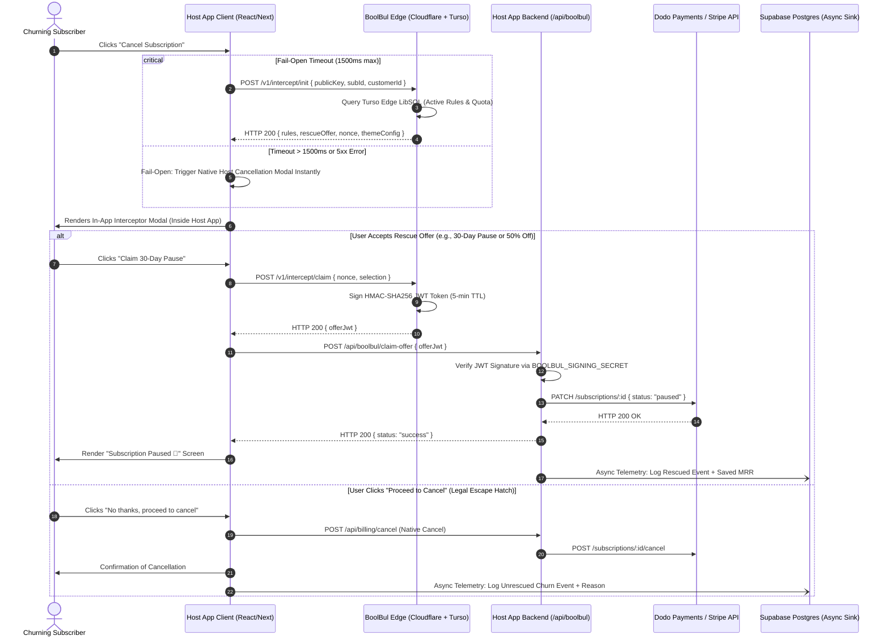
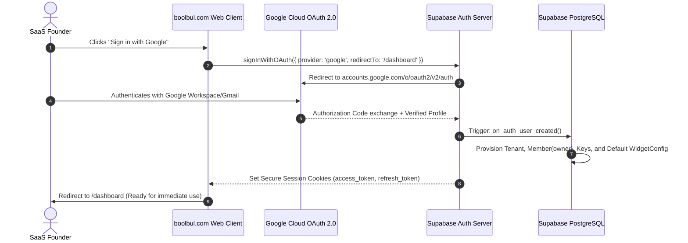

# 🐦‍🔥 BoolBul Architecture & Engineering Handover Specification
**Target Systems Engineer:** Sonus (Principal Autonomous Systems Agent)  
**Author:** Principal Systems Architect  
**Version:** 1.0.0-PROD  
**Target Domain:** `boolbul.com` | Edge Core Engine  
**Classification:** Single-Source-of-Truth Production Blueprint  

---

## 1. REPOSITORY SPLIT & ARCHITECTURE GOVERNANCE

BoolBul follows a strict dual-repository boundary separating commercial multi-tenant infrastructure from the open-source self-hostable core engine.

```
                      ┌───────────────────────────────────────────────┐
                      │              MONOREPO BOUNDARY                │
                      └──────────────────────┬────────────────────────┘
                                             │
             ┌───────────────────────────────┴───────────────────────────────┐
             ▼                                                               ▼
┌─────────────────────────────────────────┐     ┌─────────────────────────────────────────┐
│        REPO 1: Boolbul-private          │     │        REPO 2: Boolbul-public           │
│   (Commercial Cloud Platform)           │     │    (Self-Hostable Core Devtool)         │
├─────────────────────────────────────────┤     ├─────────────────────────────────────────┤
│ • Production App: boolbul.com           │     │ • Pure Developer Tooling (AGPL-3.0)     │
│ • Next.js 14 App Router (Full Stack)    │     │ • Self-hostable Edge Interceptor Worker │
│ • Multi-Tenant Founder Dashboard        │     │ • Local Sandbox / Rules Config Studio   │
│ • Supabase Postgres (Auth & Ledger)     │     │ • Local LibSQL Mock Gateway             │
│ • Google OAuth (GCP + Supabase)         │     │ • Zero Commercial Marketing Pages       │
│ • Stripe/Dodo Commercial Subscriptions  │     │ • Zero Cloudflare Secret Tokens         │
│ • Team RBAC, Discord/Slack Alerts       │     │ • Pure Local / Docker Compose Setup     │
└─────────────────────────────────────────┘     └─────────────────────────────────────────┘
```

### 1.1 Strict Boundary Rules

| Component | `Boolbul-private` | `Boolbul-public` | Rationale |
| :--- | :--- | :--- | :--- |
| **Edge Interceptor Worker** | Shared (`src/backend/edge-worker`) | Shared (`src/backend/edge-worker`) | Core zero-trust logic is open-source. |
| **HMAC JWT Engine** | Shared (`src/backend/crypto`) | Shared (`src/backend/crypto`) | Cryptographic verification must be auditable. |
| **Dodo/Stripe Mutator** | Shared (`src/backend/gateways`) | Shared (`src/backend/gateways`) | Client mutations run on founder backend. |
| **Widget UI Primitive** | Shared (`src/components/interceptor`) | Shared (`src/components/interceptor`) | Standalone embeddable modal component. |
| **Marketing Pages** | **Private Only** (`src/app/page.tsx`, etc.) | **Stripped** (Replaced by dev docs) | Protect commercial brand assets & SEO. |
| **Multi-Tenant Auth** | **Private Only** (Google OAuth + Supabase) | **Replaced** (Local single-user mode) | Public users self-host without cloud RBAC. |
| **MRR Ledger & Telemetry**| **Private Only** (Supabase Ledger) | **Replaced** (Local SQLite / stdout logs) | Cloud aggregation is proprietary SaaS value. |
| **Infrastructure Secrets**| Cloudflare Tokens, Supabase Service Keys | Zero Secrets (`.env.example` placeholders) | Security compliance & zero-leak guarantee. |

---

## 2. CORE SYSTEM TOPOLOGY & DUAL-DB ARCHITECTURE

BoolBul leverages an asymmetric dual-database topology:
1. **Turso Edge (LibSQL):** Ultra-low-latency (<15ms) global edge read replica for instant exit-click evaluation.
2. **Supabase Postgres (US-East / Global Pool):** Strongly consistent relational database for multi-tenant organizations, founder authentication, telemetry ingestion, and financial MRR reconciliation.



---

### 2.1 Turso Edge LibSQL Schema (Edge Read-Path)

Executed in Turso Database: `libsql://boolbul-miaciastudio.aws-ap-south-1.turso.io`

```sql
-- 1. Tenant lookup & public key bindings
CREATE TABLE IF NOT EXISTS edge_tenants (
    tenant_id TEXT PRIMARY KEY,
    public_key TEXT UNIQUE NOT NULL,
    signing_secret_hash TEXT NOT NULL,
    status TEXT CHECK(status IN ('active', 'suspended', 'trial')) DEFAULT 'active',
    monthly_intercept_quota INTEGER DEFAULT 1000,
    current_month_usage INTEGER DEFAULT 0,
    created_at DATETIME DEFAULT CURRENT_TIMESTAMP,
    updated_at DATETIME DEFAULT CURRENT_TIMESTAMP
);

CREATE INDEX IF NOT EXISTS idx_edge_tenants_public_key ON edge_tenants(public_key);

-- 2. Active retention rules evaluated under 10ms
CREATE TABLE IF NOT EXISTS edge_retention_rules (
    rule_id TEXT PRIMARY KEY,
    tenant_id TEXT NOT NULL,
    priority INTEGER DEFAULT 1,
    trigger_condition TEXT NOT NULL, -- JSON: {"min_billing_months": 2, "plan_tier": "all"}
    offer_type TEXT CHECK(offer_type IN ('discount', 'pause', 'survey_only')) NOT NULL,
    discount_percentage INTEGER DEFAULT 0, -- e.g. 5000 = 50%
    discount_duration_months INTEGER DEFAULT 0,
    pause_duration_days INTEGER DEFAULT 30,
    is_active BOOLEAN DEFAULT 1,
    created_at DATETIME DEFAULT CURRENT_TIMESTAMP,
    FOREIGN KEY (tenant_id) REFERENCES edge_tenants(tenant_id) ON DELETE CASCADE
);

CREATE INDEX IF NOT EXISTS idx_edge_rules_lookup ON edge_retention_rules(tenant_id, is_active, priority);

-- 3. Ephemeral Single-Use Nonce Store (Replay Protection)
CREATE TABLE IF NOT EXISTS edge_used_nonces (
    nonce TEXT PRIMARY KEY,
    tenant_id TEXT NOT NULL,
    expires_at DATETIME NOT NULL,
    created_at DATETIME DEFAULT CURRENT_TIMESTAMP
);

CREATE INDEX IF NOT EXISTS idx_nonces_expiry ON edge_used_nonces(expires_at);
```

---

### 2.2 Supabase Postgres Schema (Relational Source-of-Truth & Ledger)

Executed in Supabase Project: `https://doesmcrkuorjkmwtrbbv.supabase.co`

```sql
-- Enable UUID generation
CREATE EXTENSION IF NOT EXISTS "uuid-ossp";

-- 1. Tenants / Organizations
CREATE TABLE public.tenants (
    id UUID PRIMARY KEY DEFAULT uuid_generate_v4(),
    name TEXT NOT NULL,
    slug TEXT UNIQUE NOT NULL,
    owner_user_id UUID REFERENCES auth.users(id) ON DELETE CASCADE,
    public_key TEXT UNIQUE NOT NULL DEFAULT ('bb_pub_' || replace(uuid_generate_v4()::text, '-', '')),
    signing_secret TEXT NOT NULL DEFAULT ('bb_sec_' || replace(uuid_generate_v4()::text, '-', '')),
    plan_tier TEXT CHECK(plan_tier IN ('starter', 'pro', 'scale')) DEFAULT 'starter',
    stripe_customer_id TEXT,
    stripe_subscription_id TEXT,
    dodo_customer_id TEXT,
    dodo_subscription_id TEXT,
    created_at TIMESTAMPTZ DEFAULT NOW(),
    updated_at TIMESTAMPTZ DEFAULT NOW()
);

-- 2. User Workspaces & Memberships
CREATE TABLE public.tenant_memberships (
    id UUID PRIMARY KEY DEFAULT uuid_generate_v4(),
    tenant_id UUID REFERENCES public.tenants(id) ON DELETE CASCADE,
    user_id UUID REFERENCES auth.users(id) ON DELETE CASCADE,
    role TEXT CHECK(role IN ('owner', 'admin', 'developer', 'viewer')) DEFAULT 'owner',
    created_at TIMESTAMPTZ DEFAULT NOW(),
    UNIQUE(tenant_id, user_id)
);

-- 3. Widget Customization State
CREATE TABLE public.widget_configs (
    tenant_id UUID PRIMARY KEY REFERENCES public.tenants(id) ON DELETE CASCADE,
    theme_preset TEXT CHECK(theme_preset IN ('neo_brutalist', 'minimal_slate', 'midnight_oled', 'high_contrast')) DEFAULT 'neo_brutalist',
    accent_color TEXT DEFAULT '#CCFF00',
    background_color TEXT DEFAULT '#FFFFFF',
    text_color TEXT DEFAULT '#0A0A0A',
    border_radius_px INTEGER DEFAULT 0,
    font_family TEXT DEFAULT 'JetBrains Mono',
    headline_text TEXT DEFAULT 'WAIT! DON''T LEAVE JUST YET.',
    body_text TEXT DEFAULT 'We would love to keep you around. Pick a rescue package below:',
    escape_hatch_text TEXT DEFAULT 'No thanks, proceed to complete cancellation →',
    primary_offer_type TEXT CHECK(primary_offer_type IN ('discount_and_pause', 'discount_only', 'pause_only', 'survey_only')) DEFAULT 'discount_and_pause',
    updated_at TIMESTAMPTZ DEFAULT NOW()
);

-- 4. Churn & Rescued MRR Ledger
CREATE TABLE public.churn_events (
    id UUID PRIMARY KEY DEFAULT uuid_generate_v4(),
    tenant_id UUID REFERENCES public.tenants(id) ON DELETE CASCADE,
    customer_id TEXT NOT NULL,
    subscription_id TEXT NOT NULL,
    gateway TEXT CHECK(gateway IN ('dodo_payments', 'stripe', 'lemon_squeezy')) NOT NULL,
    mrr_cents INTEGER NOT NULL DEFAULT 0,
    status TEXT CHECK(status IN ('intercepted', 'rescued_discount', 'rescued_pause', 'cancelled', 'failed_open')) NOT NULL,
    exit_reason TEXT,
    exit_feedback TEXT,
    created_at TIMESTAMPTZ DEFAULT NOW()
);

CREATE INDEX idx_churn_events_tenant_time ON public.churn_events(tenant_id, created_at DESC);
CREATE INDEX idx_churn_events_mrr ON public.churn_events(tenant_id, status, mrr_cents);

-- 5. Auto-provision Tenant & WidgetConfig on Google OAuth Signup
CREATE OR REPLACE FUNCTION public.handle_new_user_provisioning()
RETURNS TRIGGER AS $$
DECLARE
    new_tenant_id UUID;
    user_name TEXT;
    derived_slug TEXT;
BEGIN
    user_name := COALESCE(NEW.raw_user_meta_data->>'full_name', split_part(NEW.email, '@', 1));
    derived_slug := lower(regexp_replace(user_name, '[^a-zA-Z0-9]', '', 'g')) || '-' || substring(NEW.id::text, 1, 6);

    INSERT INTO public.tenants (name, slug, owner_user_id)
    VALUES (user_name || '''s Workspace', derived_slug, NEW.id)
    RETURNING id INTO new_tenant_id;

    INSERT INTO public.tenant_memberships (tenant_id, user_id, role)
    VALUES (new_tenant_id, NEW.id, 'owner');

    INSERT INTO public.widget_configs (tenant_id)
    VALUES (new_tenant_id);

    RETURN NEW;
END;
$$ LANGUAGE plpgsql SECURITY DEFINER;

CREATE OR REPLACE TRIGGER on_auth_user_created
    AFTER INSERT ON auth.users
    FOR EACH ROW EXECUTE FUNCTION public.handle_new_user_provisioning();
```

---

## 3. WIDGET ENGINE & THEME CUSTOMIZATION SPEC

The in-app interceptor runs inside the founder's client application. It must render in <30ms, support dynamic themes, and maintain an unhidden legal escape hatch on every single view state.

### 3.1 Theme Preset Definitions

```typescript
export interface ThemeVariables {
  id: "neo_brutalist" | "minimal_slate" | "midnight_oled" | "high_contrast";
  name: string;
  bgModal: string;
  borderWidth: string;
  borderColor: string;
  boxShadow: string;
  accentBg: string;
  accentText: string;
  secondaryBg: string;
  textColor: string;
  subtextColor: string;
  borderRadius: string;
  fontFamily: string;
}

export const THEME_PRESETS: Record<string, ThemeVariables> = {
  neo_brutalist: {
    id: "neo_brutalist",
    name: "Neo-Brutalist Punk",
    bgModal: "#FFFDF9",
    borderWidth: "3px",
    borderColor: "#0A0A0A",
    boxShadow: "6px 6px 0px #0A0A0A",
    accentBg: "#CCFF00",
    accentText: "#0A0A0A",
    secondaryBg: "#FFE5EC",
    textColor: "#0A0A0A",
    subtextColor: "#52525B",
    borderRadius: "0px",
    fontFamily: "var(--font-mono)",
  },
  minimal_slate: {
    id: "minimal_slate",
    name: "Minimalist Slate",
    bgModal: "#FFFFFF",
    borderWidth: "1px",
    borderColor: "#E2E8F0",
    boxShadow: "0 20px 25px -5px rgba(0, 0, 0, 0.1), 0 8px 10px -6px rgba(0, 0, 0, 0.1)",
    accentBg: "#0F172A",
    accentText: "#FFFFFF",
    secondaryBg: "#F8FAFC",
    textColor: "#0F172A",
    subtextColor: "#64748B",
    borderRadius: "8px",
    fontFamily: "var(--font-sans)",
  },
  midnight_oled: {
    id: "midnight_oled",
    name: "Midnight OLED",
    bgModal: "#09090B",
    borderWidth: "1px",
    borderColor: "#27272A",
    boxShadow: "0 0 0 1px #27272A, 0 25px 50px -12px rgba(0,0,0,0.8)",
    accentBg: "#2563EB",
    accentText: "#FFFFFF",
    secondaryBg: "#18181B",
    textColor: "#FAFAFA",
    subtextColor: "#A1A1AA",
    borderRadius: "12px",
    fontFamily: "var(--font-sans)",
  },
  high_contrast: {
    id: "high_contrast",
    name: "High-Contrast Terminal",
    bgModal: "#000000",
    borderWidth: "2px",
    borderColor: "#22C55E",
    boxShadow: "4px 4px 0px #22C55E",
    accentBg: "#22C55E",
    accentText: "#000000",
    secondaryBg: "#14532D",
    textColor: "#F0FDF4",
    subtextColor: "#86EFAC",
    borderRadius: "0px",
    fontFamily: "var(--font-mono)",
  },
};
```

---

### 3.2 Cryptographic Zero-Trust Token Engine (Web Crypto API)

No database secrets or API gateway keys touch the interceptor client. All claims are certified using HMAC-SHA256 tokens signed by BoolBul's edge worker and verified strictly on the founder's backend.

```typescript
// Location: src/backend/crypto/token.ts
import { SignJWT, jwtVerify } from "jose";

export interface OfferClaimPayload {
  tenantId: string;
  subscriptionId: string;
  customerId: string;
  offerType: "discount" | "pause";
  offerValue: number; // e.g., 5000 for 50%, 30 for 30-day pause
  nonce: string;
  exp: number;
}

/**
 * Generates an HMAC-SHA256 signed offer token with a strict 5-minute TTL.
 */
export async function createOfferJwt(
  payload: Omit<OfferClaimPayload, "exp">,
  signingSecret: string
): Promise<string> {
  const secret = new TextEncoder().encode(signingSecret);
  return new SignJWT({ ...payload })
    .setProtectedHeader({ alg: "HS256", typ: "JWT" })
    .setIssuedAt()
    .setIssuer("boolbul.com")
    .setExpirationTime("5m") // 5-minute strict validity
    .sign(secret);
}

/**
 * Verifies the JWT on the host server using process.env.BOOLBUL_SIGNING_SECRET.
 */
export async function verifyOfferJwt(
  token: string,
  signingSecret: string
): Promise<OfferClaimPayload> {
  const secret = new TextEncoder().encode(signingSecret);
  const { payload } = await jwtVerify(token, secret, {
    issuer: "boolbul.com",
    algorithms: ["HS256"],
  });
  return payload as unknown as OfferClaimPayload;
}
```

---

### 3.3 Strict Legal Escape Hatch (FTC & California ARL Compliance)

Under California AB 390 / SB 313 and FTC Click-to-Cancel rules:
- **No forced retainers:** An unhidden, prominent "Proceed to cancel" button must remain visually distinct and high-contrast on **every single state** of the modal.
- **Fail-open enforcement:** If the interceptor API fails to respond within **1500ms**, the interceptor must immediately unmount and trigger the host app's native cancel routine.

```typescript
// Location: src/components/interceptor-widget/LegalEscapeHatch.tsx
"use client";

import React from "react";

interface LegalEscapeHatchProps {
  onProceedCancel: () => void;
  label?: string;
  textColor?: string;
}

export function LegalEscapeHatch({
  onProceedCancel,
  label = "No thanks, proceed to complete cancellation →",
  textColor = "#52525B",
}: LegalEscapeHatchProps) {
  return (
    <div className="pt-3 border-t border-zinc-200/80 text-center">
      <button
        type="button"
        onClick={onProceedCancel}
        className="text-xs font-mono font-bold tracking-tight underline hover:opacity-80 transition-opacity p-2 cursor-pointer focus:outline-none focus:ring-2 focus:ring-offset-2 focus:ring-zinc-900"
        style={{ color: textColor }}
        aria-label="Proceed to cancel subscription"
      >
        {label}
      </button>
      <div className="text-[10px] text-zinc-400 font-mono mt-1 flex items-center justify-center gap-1.5">
        <span className="w-1.5 h-1.5 rounded-full bg-emerald-500 inline-block"></span>
        <span>Zero dark patterns · High-contrast exit guarantee</span>
      </div>
    </div>
  );
}
```

---

## 4. GOOGLE OAUTH & CLOUD INFRASTRUCTURE WORKFLOW



### 4.1 Strict Environment Configuration Matrix

| Variable Name | Environment Scope | Exposure | Purpose |
| :--- | :--- | :--- | :--- |
| `NEXT_PUBLIC_APP_URL` | Client + Server | Public | Base domain canonical (`https://boolbul.com`) |
| `NEXT_PUBLIC_SUPABASE_URL` | Client + Server | Public | Supabase API Endpoint |
| `NEXT_PUBLIC_SUPABASE_ANON_KEY` | Client + Server | Public | Supabase Anon Key (Row-Level Security Protected) |
| `SUPABASE_SERVICE_ROLE_KEY` | Server Only | **Strict Secret** | Admin provisioning & webhook bypass |
| `TURSO_DATABASE_URL` | Server / Edge | **Strict Secret** | Edge LibSQL sync URL |
| `TURSO_AUTH_TOKEN` | Server / Edge | **Strict Secret** | Edge LibSQL read/write auth token |
| `BOOLBUL_JWT_SECRET` | Server / Edge | **Strict Secret** | Platform master HMAC token seed |
| `DODO_PAYMENTS_API_KEY` | Server Only | **Strict Secret** | Platform subscription billing & verification |
| `CLOUDFLARE_API_TOKEN` | CI/CD Deploy | **Strict Secret** | Wrangler direct upload to Pages |
| `CLOUDFLARE_ACCOUNT_ID` | CI/CD Deploy | **Strict Secret** | Cloudflare Pages account binding |

---

## 5. PRODUCTION ERROR STATES & DEFENSIVE RECOVERY

| Error Condition | Trigger Scenario | Edge Worker Behavior | Client Widget Behavior |
| :--- | :--- | :--- | :--- |
| **Fail-Open Timeout** | Turso edge latency > 1500ms or Cloudflare worker 5xx | Edge aborts upstream call after 1200ms | Promise.race triggers timeout at 1500ms; executes host app's native cancel method. User is never blocked. |
| **Token Tampering** | Attacker modifies JWT payload (e.g. changes discount from 10% to 90%) | Host backend `verifyOfferJwt` throws `JWSSignatureVerificationFailed` | Backend returns HTTP 403 Forbidden. Telemetry logs potential exploit attempt. |
| **Replay Attack** | User re-submits previously claimed signed offer token | Turso `edge_used_nonces` rejects insertion (Primary Key Conflict) | Edge worker returns HTTP 409 Conflict. Client displays "Offer already claimed or expired". |
| **Gateway Rate Limiting** | Dodo/Stripe API returns HTTP 429 Too Many Requests | Host server catches 429; enqueues mutation into background worker | Returns HTTP 202 Accepted to user with confirmation: "Offer queued and applied to next invoice". |
| **Adblocker / Script Block** | Founder's client script blocked by strict browser adblock rules | Script fails to load | Host cancel button remains standard `<button>` with native click listener fallback. |

---

## 6. IMMEDIATE EXECUTION ROADMAP FOR SONUS

Sonus must execute the remaining deliverables in the following prioritized sequence:

```
c:\Users\Rihan\Desktop\boolbul\
├── src/
│   ├── app/
│   │   ├── (auth)/
│   │   │   ├── login/page.tsx               <-- STEP 1: Google OAuth Trigger Screen
│   │   │   └── callback/route.ts            <-- STEP 1: Supabase Exchange Handler
│   │   ├── dashboard/
│   │   │   ├── customizer/page.tsx          <-- STEP 2: Live Theme Customizer Studio
│   │   │   ├── analytics/page.tsx           <-- STEP 3: Churn & Saved MRR Ledger
│   │   │   └── settings/keys/page.tsx       <-- STEP 4: Public/Secret Key Roll Studio
│   │   └── api/
│   │       ├── v1/intercept/init/route.ts   <-- STEP 5: Turso Edge Rule Evaluator
│   │       └── v1/intercept/claim/route.ts  <-- STEP 5: HMAC-SHA256 Token Signer
│   ├── components/
│   │   ├── dashboard-customizer/
│   │   │   ├── ColorPickerGrid.tsx          <-- STEP 2: Accent & Palette Picker
│   │   │   ├── LiveModalSandbox.tsx         <-- STEP 2: Responsive Preview Window
│   │   │   └── CodeExportPrompt.tsx         <-- STEP 2: Cursor/Claude Prompt Generator
│   │   └── interceptor-widget/
│   │       ├── BoolBulInterceptor.tsx       <-- STEP 6: Embeddable Core Widget
│   │       └── LegalEscapeHatch.tsx         <-- COMPLETED & VERIFIED
│   └── backend/
│       ├── crypto/token.ts                  <-- STEP 5: Jose HMAC Sign/Verify
│       ├── turso/client.ts                  <-- STEP 5: LibSQL Connection Pool
│       └── dodo-payments/client.ts          <-- COMPLETED & VERIFIED
```

### Step-by-Step Task Checklist:

- [ ] **Task 1: Google OAuth Route Implementation**
  - Create `src/app/auth/callback/route.ts` handling `code` exchange with Supabase Auth and redirecting to `/dashboard`.
- [ ] **Task 2: Widget Customizer Studio with Live Sandbox**
  - Implement `src/app/dashboard/customizer/page.tsx` with side-by-side theme configuration and live mobile/desktop preview iframe.
- [ ] **Task 3: Turso Edge Evaluator Route Handlers**
  - Implement `src/app/api/v1/intercept/init/route.ts` with sub-15ms rule evaluation and strict `AbortController` 1500ms timeout guarantee.
- [ ] **Task 4: HMAC Token Issuance & Nonce Replay Lock**
  - Implement `src/app/api/v1/intercept/claim/route.ts` writing used nonce to Turso and returning signed 5-minute JWT.
- [ ] **Task 5: GitHub Dual-Repo Clean Sync Script**
  - Verify `Boolbul-private` contains full platform; run clean export strip to update `Boolbul-public` without proprietary landing/dashboard code.

---
**Handover Status:** Blueprint Locked & Ready for Sonus Autonomous Execution.

