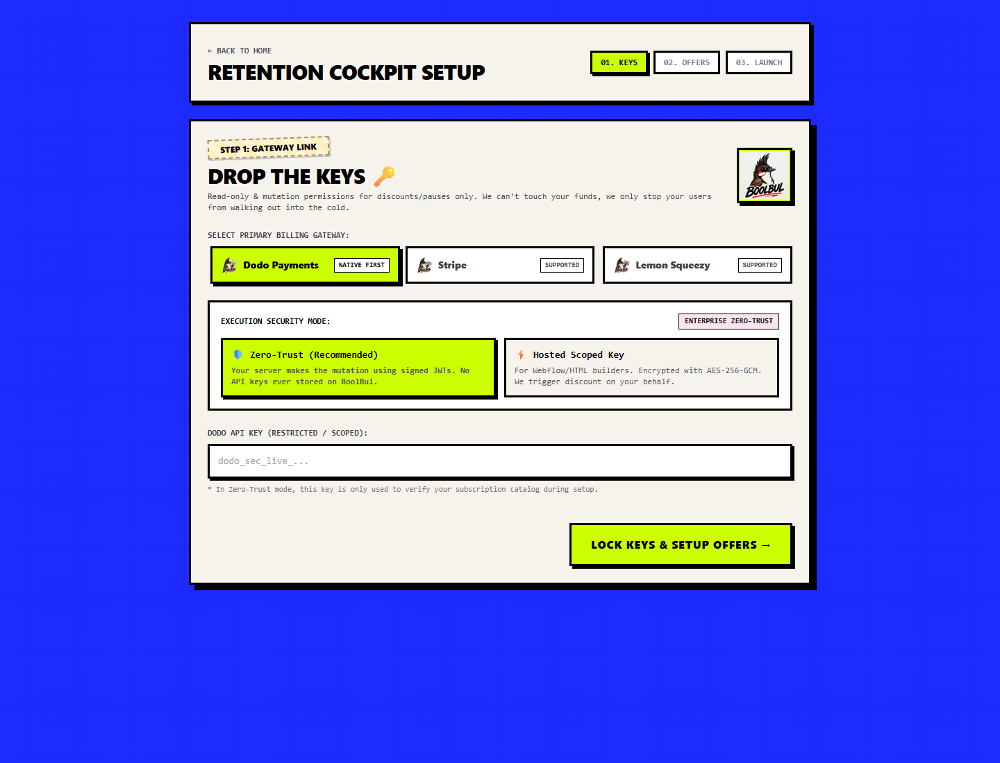
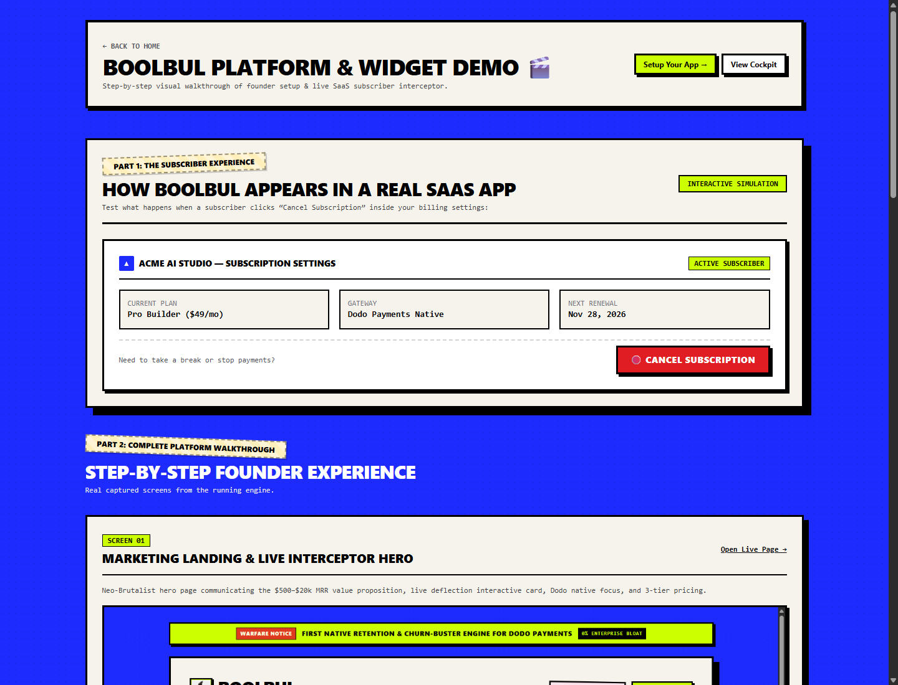
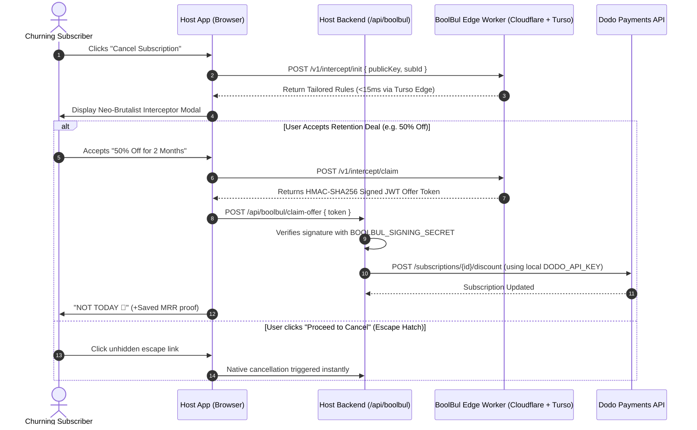

<div align="center">

# 🐦‍🔥 BOOLBUL (`boolbul.com`)
### *The First Native Retention & Churn-Buster Engine for Dodo Payments.*

[](https://www.gnu.org/licenses/agpl-3.0)
[](https://nextjs.org/)
[](https://tailwindcss.com/)
[](https://turso.tech/)
[](https://workers.cloudflare.com/)
[](https://dodopayments.com/)

**Stop letting subscribers walk out into the cold. Deflect cancellations, freeze churn, and protect your MRR in 45 seconds.**

[🌐 Live Hosted Cloud](https://boolbul.com) • [🎬 Live Walkthrough Demo](https://boolbul.com/demo) • [⚡ 45-Sec Setup](#-45-second-setup-cursor--claude) • [🛡️ Zero-Trust Model](#-zero-trust-architecture)

</div>

---

## ⚡ The Core Problem

Solo builders, vibe-coders, and indie founders ($500 to $20k MRR) spend months building great software, only to lose **30%–45% of customer lifetime value** because they lack a cancellation deflection flow.

While Stripe and Paddle have enterprise tools, **Dodo Payments** (the fastest-growing global/Indian merchant of record) has zero native cancel modals. 

**BoolBul intercepts cancellations the microsecond a subscriber clicks "Cancel":**
1. **Dynamic Rescue Offers:** Automatically serves 50% discounts or 30-day pauses.
2. **Zero-Trust Security:** We never touch your secret gateway keys. Our edge worker issues signed HMAC-SHA256 JWTs; your own server mutates Dodo Payments.
3. **1500ms Fail-Open Guarantee:** If our edge worker or the network hangs, the interceptor silently yields to the host app's native cancel event. Your users are never trapped.
4. **100% FTC & California AB 390 Compliant:** Unhidden, prominent "Proceed to Cancel" escape hatch on every single modal state. No dark patterns, zero chargeback disputes.

---

## 📸 Platform Screenshots

| Marketing Landing & Interceptor Hero | Onboarding: Drop The Keys & Zero-Trust |
| :---: | :---: |
|  |  |

| Founder Cockpit & Saved MRR Ledger | Real-World SaaS Interception Simulation |
| :---: | :---: |
|  |  |

---

## 🛡️ Zero-Trust Architecture



---

## ⚡ 45-Second Setup (Cursor / Claude)

Copy and paste this prompt directly into your AI terminal:

```markdown
Integrate BoolBul retention flow into this Next.js App Router codebase:

CREDENTIALS:
- BOOLBUL_PUBLIC_KEY: "bb_pub_..."
- BOOLBUL_SIGNING_SECRET: "bb_sec_..."
- DODO_PAYMENTS_API_KEY: process.env.DODO_PAYMENTS_API_KEY

STEPS:
1. Create `app/api/boolbul/claim-offer/route.ts` to verify HMAC-SHA256 token and call Dodo `/subscriptions/${id}/discount`.
2. Wrap the billing page "Cancel Subscription" button with BoolBul interceptor.
3. Fail open in 1200ms if network drops.
```

---

## 🚀 Quickstart & Self-Hosting

### 1. Clone & Install
```bash
git clone https://github.com/miaciastudio/Boolbul-public.git
cd Boolbul-public
npm install
```

### 2. Configure Environment
```bash
cp .env.example .env.local
```
Add your credentials:
* **Turso Edge LibSQL:** `TURSO_DATABASE_URL` & `TURSO_AUTH_TOKEN`
* **Supabase:** `NEXT_PUBLIC_SUPABASE_URL` & `SUPABASE_SERVICE_ROLE_KEY`
* **Dodo Payments:** `DODO_PAYMENTS_API_KEY` & `DODO_PAYMENTS_WEBHOOK_KEY`

### 3. Run Locally
```bash
npm run dev
```
Open [http://localhost:3000](http://localhost:3000) to view the cockpit.

---

## ⚖️ License & Open Source Terms

* **Core Engine:** Licensed under the **GNU Affero General Public License v3.0 (AGPL-3.0)**.
* **Hosted Cloud Offering:** Available at [boolbul.com](https://boolbul.com) with managed global Cloudflare Workers, instant Turso edge replicas, and webhook bots.

---

<div align="center">
Built with 🖤 by <a href="https://github.com/miaciastudio">Miacia Studio</a> for the global indie hacker community.
</div>
