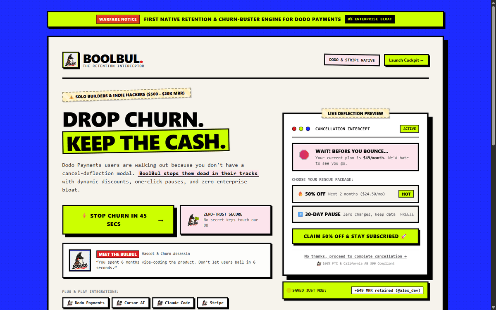
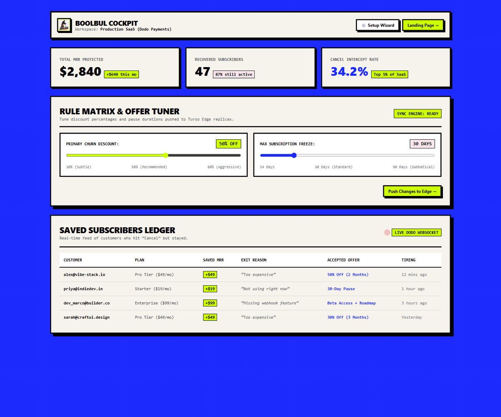
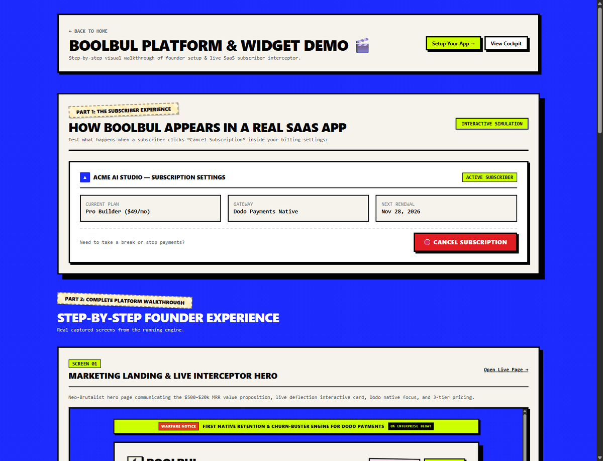
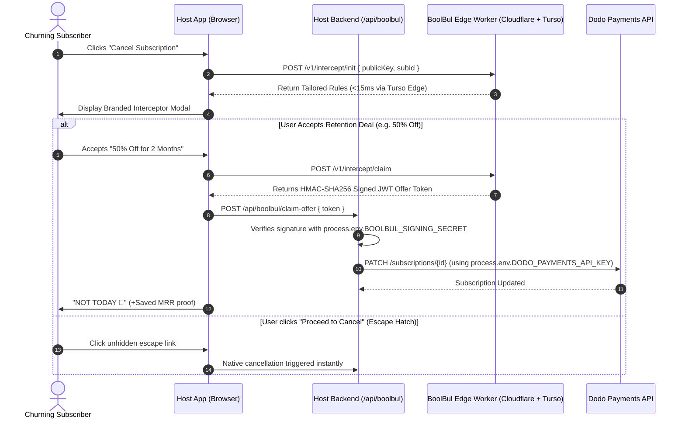

<div align="center">

# 🐦‍🔥 BOOLBUL (`boolbul.com`)
### *Lightweight, In-App Cancellation Interceptor for Indie SaaS Builders.*

[](https://www.gnu.org/licenses/agpl-3.0)
[](https://nextjs.org/)
[](https://tailwindcss.com/)
[](https://turso.tech/)
[](https://pages.cloudflare.com/)
[](https://dodopayments.com/)

**Don't kick churning users to an external billing portal. Keep subscribers inside your app with customizable exit pauses, dynamic discounts, and real exit feedback.**

[🌐 Live Hosted Cloud](https://boolbul.com) • [📚 Developer Docs](https://boolbul.com/docs) • [🎬 Live Walkthrough Demo](https://boolbul.com/demo) • [⚡ 45-Sec Setup](#-45-second-setup-cursor--claude) • [🛡️ Zero-Trust Model](#-zero-trust-architecture)

</div>

---

## ⚡ The Core Problem

Solo builders, vibe-coders, and indie founders ($500 to $20k MRR) spend months building great software, only to lose substantial customer lifetime value because they lack an in-app exit-intent flow.

While billing gateways offer generic hosted customer portals, redirecting users out of your application leads to lost engagement and blind churn.

**BoolBul keeps subscribers inside your app and intercepts cancellations the moment they click "Cancel":**
1. **Dynamic Rescue Offers:** Automatically serves 50% discounts or 30-day pauses right inside your app.
2. **Exit Reason Telemetry:** Collects actual qualitative feedback before a subscriber leaves.
3. **Zero-Trust Security:** We never touch your secret gateway keys. Our edge worker issues signed HMAC-SHA256 JWTs; your own server mutates Dodo Payments or Stripe.
4. **1500ms Fail-Open Guarantee:** If our edge worker or the network hangs, the interceptor silently yields to the host app's native cancel event. Your users are never trapped.
5. **Zero Dark Patterns:** Unhidden, high-contrast "Proceed to Cancel" escape hatch on every single modal state. Transparent compliance with 16 CFR Part 425 & California ARL.

---

## 📸 Platform Screenshots

| Marketing Landing & Interceptor Hero | Onboarding: 4-Step Key Generation |
| :---: | :---: |
|  |  |

| Founder Cockpit & Saved MRR Ledger | Real-World SaaS Interception Simulation |
| :---: | :---: |
|  |  |

---

## 🎨 Theme Matrix & Customizer

BoolBul provides a live theme switcher and customizer accessible from `/dashboard/customizer`:
- **Neo-Brutalist (Default)**: Retro high-voltage punk, pitch-black 3px borders, electric lime accents, and hard drop shadows.
- **Minimal Slate**: Refined Linear / Vercel monochrome aesthetic for modern productivity tools.
- **Midnight OLED**: High-contrast dark mode for terminal tools and developer-centric SaaS.

All themes enforce non-negotiable FTC anti-dark pattern guardrails with high-contrast escape hatches.

---

## 🛡️ Zero-Trust Architecture



---

## 📖 Developer Documentation Hub

Visit [`https://boolbul.com/docs`](https://boolbul.com/docs) for full interactive documentation:
* [Quickstart (5-Minute Guide)](https://boolbul.com/docs/quickstart)
* [Client SDK & Fail-Open Contract](https://boolbul.com/docs/client-sdk)
* [Dodo Payments & Stripe Webhooks](https://boolbul.com/docs/webhooks)
* [FTC 16 CFR Part 425 & California ARL Compliance](https://boolbul.com/docs/ftc-compliance)
* [AI Agent Specs (`llms.txt`)](https://boolbul.com/llms.txt)

---

## 📦 Appwrite Cloud Function Template

For founders hosting on Appwrite Cloud, check [`examples/appwrite-dodo-retention`](examples/appwrite-dodo-retention):
A production-ready TypeScript Appwrite Cloud Function that verifies Dodo Payments subscription cancellations against BoolBul edge signatures.

---

## ⚡ 45-Second Setup (Cursor / Claude)

Add your credentials to `.env.local`:
```bash
NEXT_PUBLIC_BOOLBUL_PUBLIC_KEY="bb_pub_live_..."
BOOLBUL_SIGNING_SECRET="bb_sec_live_..."
DODO_PAYMENTS_API_KEY="dodo_api_live_..."
```

Then copy and paste this prompt directly into your AI terminal:

```markdown
Integrate BoolBul retention flow into this Next.js App Router codebase:

SECURITY:
- Read NEXT_PUBLIC_BOOLBUL_PUBLIC_KEY from process.env
- Read BOOLBUL_SIGNING_SECRET and DODO_PAYMENTS_API_KEY server-side ONLY from process.env

STEPS:
1. Create `app/api/boolbul/claim-offer/route.ts` to verify the HMAC-SHA256 signature using BOOLBUL_SIGNING_SECRET and call Dodo Payments API `PATCH /subscriptions/{id}` with the granted discount_code or pause status.
2. Wrap the billing page "Cancel Subscription" button with the BoolBul interceptor client component.
3. Enforce a strict 1500ms fail-open timeout so if network drops or the interceptor times out, user cancellation proceeds normally with zero disruption.
```

---

## 🚀 Quickstart & Self-Hosting

### 1. Clone & Install
```bash
git clone https://github.com/miaciastudio/Boolbul-public.git
cd Boolbul-public
npm install
```

### 2. Configure Environment
```bash
cp .env.example .env.local
```
Add your credentials:
* **Turso Edge LibSQL:** `TURSO_DATABASE_URL` & `TURSO_AUTH_TOKEN`
* **Supabase:** `NEXT_PUBLIC_SUPABASE_URL` & `SUPABASE_SERVICE_ROLE_KEY`
* **Dodo Payments:** `DODO_PAYMENTS_API_KEY` & `DODO_PAYMENTS_WEBHOOK_KEY`

### 3. Run Locally & Test
```bash
npm run dev
npm test
```
Open [http://localhost:3000](http://localhost:3000) to view the cockpit.

---

## ⚖️ License & Open Source Terms

* **Core Engine:** Licensed under the **GNU Affero General Public License v3.0 (AGPL-3.0)**.
* **Hosted Cloud Offering:** Available at [boolbul.com](https://boolbul.com) with managed global Cloudflare Workers, instant Turso edge replicas, and webhook bots.

---

<div align="center">
Built with 🖤 by <a href="https://github.com/miaciastudio">Miacia Studio</a> for the global indie hacker community.
</div>
